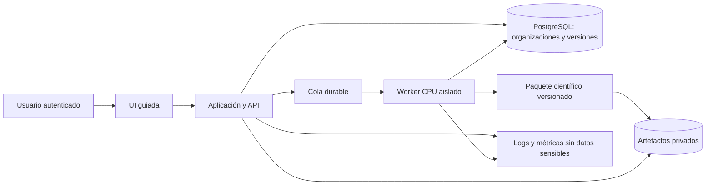

# Arquitectura recomendada y alternativas

Recomendación basada en auditoría de master `6f3a8b9`, 16-10-2026. No cambia ADR ni código. La selección contractual se toma en T06 después de comprobar competencias del proveedor y requisitos del piloto.

## Preservar el motor; profesionalizar el producto

El contrato natural ya existe: configuración → ejecución → artefactos. Mantener el paquete Python como núcleo versionado; los CSV/JSON y reportes son productos de la ejecución. La UI nunca debe recalcular DCF, CAC o cohortes. La empresa aporta seguridad, persistencia y experiencia; Alonso mantiene autoridad sobre metodología y referencia numérica.

ADR0017 es razonable para un consultor con casos secuenciales. El nuevo alcance requiere organizaciones, concurrencia y jobs independientes del navegador; activa sus propios criterios de extracción. No es evidencia a favor de microservicios ni de reescritura del solver.

## Opciones comparadas

| Opción | Ventaja | Coste / riesgo | Adecuación |
|---|---|---|---|
| Streamlit local/privado reforzado | Máxima reutilización y demostración rápida | Experiencia y control multiusuario requieren cuidado; no resuelve por sí solo permisos/jobs | Piloto de consultoría asistida y fallback de alcance |
| Monolito modular Django + UI servidor/HTMX + worker Python | Auth, permisos, ORM/admin y migraciones integrados; una base tecnológica | Hay que construir experiencia gráfica y API; biblioteca de permisos no implementa tenancy automáticamente | **Base preferida para un MVP pequeño si el proveedor domina Django** |
| FastAPI + frontend React + PostgreSQL + worker | API explícita, experiencia rica y equipos separados; encaja con propuesta ADR0017 | Dos aplicaciones, contrato frontend/backend, más piezas de auth/admin/operación | Alternativa válida si equipo ya la opera y demuestra ventaja UX concreta |
| BaaS + frontend + worker científico | Acelera autenticación y persistencia administrada | Políticas de acceso, jobs y portabilidad siguen siendo responsabilidad del equipo | Considerar mediante prueba de aislamiento/exportación, no por promesa de «sin backend» |
| Microservicios/Kubernetes/agentes como orquestador central | Escalado/independencia si existieran equipos/cargas diferenciados | Complejidad de observabilidad, consistencia y operación sin necesidad demostrada | Descartar como base de ocho meses |

La recomendación Django es una inferencia de ajuste al alcance, no un hecho del repositorio. El sistema incluye autenticación y permisos reutilizables; eso reduce trabajo genérico, pero no garantiza aislamiento por organización. [Django, autenticación](https://docs.djangoproject.com/en/5.2/topics/auth/). FastAPI advierte que cálculo pesado puede necesitar una herramienta de trabajos externa; no resolver MILP largo con una tarea efímera en el proceso HTTP. [FastAPI, Background Tasks](https://fastapi.tiangolo.com/tutorial/background-tasks/).

La cotización debe comparar dos variantes del mismo alcance: monolito Python y API+React. Decidir por experiencia demostrada del proveedor, pruebas de UX y costo total de mantenimiento. No pedir al proveedor que aprenda un framework para satisfacer una preferencia sin evidencia. Autenticación gestionada puede reemplazar contraseñas propias; organizaciones, autorización y ownership siguen bajo control del backend.

## Diseño lógico propuesto

Una aplicación y un worker son **roles de ejecución**, no necesariamente microservicios independientes. Una cola sencilla con estados, reintentos y supervisión basta; Celery/Redis, una cola gestionada o mecanismo PostgreSQL son alternativas. Elegir por fiabilidad operacional y experiencia, no por popularidad. PostgreSQL guarda metadatos; objetos privados guardan documentos y resultados voluminosos. No guardar cada PNG como fila binaria sin necesidad.

Entidades mínimas: Organization, User, Membership/Role, Project/Startup, Scenario, ScenarioVersion, Execution, Artifact, AuditEvent y UsageRecord. ScenarioVersion es inmutable; una edición crea versión. Execution referencia versión, hash, versión del motor, solver, parámetros, seed, estado y tiempos. El run_id no es autorización: cada lectura/descarga/edición verifica organización y rol.

Roles iniciales: administrador de organización, analista y lector. Separar administración técnica del SaaS de los roles del cliente; evitar permisos implícitos para leer datos de toda organización. Vinculación con incubadoras/carteras se añade después de definir quién puede compartir cada startup.

## Contratos y seguridad desde el principio

- Entradas: esquema versionado, unidades/moneda/horizonte explícitos, finitud y límites de tamaño. La validación vive en backend/motor, aunque el formulario ayude.
- Ejecución: estados queued/running/succeeded/infeasible/failed/cancelled; conservar status del solver y distinguir solución diagnóstica. Idempotencia para evitar cobros o jobs duplicados. Timeout, límites H/servicios/escenarios y limpieza controlada de temporales.
- Salidas: artefactos inmutables, manifest con hashes y procedencia, permisos por objeto y URL temporal. Cifras de UI y reportes provienen de la misma ejecución.
- Renderer: corregir autoescape `.j2`, sanitizar contenido, impedir rutas fuera del directorio autorizado, limitar carga de recursos remotos y ejecutar con permisos mínimos. La prueba de auditoría muestra riesgo concreto, no sólo posibilidad teórica.
- Operación: ambientes separados, secretos fuera de Git, TLS, backups restaurados, alertas, política de retención y migraciones reversibles. Objetivos iniciales propuestos RPO 24h/RTO 8h, sujetos a prueba y contrato.
- CI: entorno limpio con dependencias declaradas, tests de contrato y negativos, pruebas de autorización, smoke PDF/XLSX, escaneo de dependencias. QA de navegador y de aislamiento complementa pytest científico.

Usar servicios gestionados para DB, objetos y autenticación cuando reduzcan carga operativa. Coste y términos de exportación/región deben revisarse al elegir proveedor. Sin acceso a cloud actual no se afirma que el proyecto carezca de cualquier control externo; sólo que esos controles no están acreditados por el repositorio.

## IA: dónde aporta y dónde no

| Necesidad | Solución base | Uso eventual de IA y condición |
|---|---|---|
| Validar tasas/unidades/restricciones | Software determinista | LLM sólo explica el error ya calculado |
| Proyectar y optimizar | Python/PuLP, fórmulas científicas | No reemplazar solve ni cifras por texto generado |
| Detectar supuestos dudosos | Reglas versionadas y referencias | LLM ayuda a redactar; cita regla y no inventa benchmark |
| Capturar información desestructurada | Formulario/importación estructurada | Extracción LLM con esquema, evidencia y confirmación humana |
| Explicar resultado | Narrativa parametrizada existente | Conversación sobre artefactos autorizados, sin modificar parámetros silenciosamente |
| Benchmarking | Fuente externa licenciada, fechada y comparable | Recuperación puede ayudar, no vuelve verdadera una cifra sin fuente |
| Ejecutar workflow estable | Orquestación determinista y cola | Agente sólo si tarea variable, herramientas acotadas y beneficio medido |
| Buscar documentos del cliente | Metadatos y búsqueda convencional | RAG cuando volumen y preguntas lo justifiquen; control por tenant antes de recuperar |

No hace falta una arquitectura multiagente para el MVP. Una prueba posterior de extracción debe medir exactitud de campos/unidades, tiempo ahorrado y costo; un experto confirma antes del motor. Inputs documentales son datos no confiables, no instrucciones para herramientas. Conservar procedencia, logs adecuados y consentimiento, evitando enviar documentos completos cuando basten campos mínimos.

## SII, datos reales y fondos VC

No hay integración SII implementada ni evidencia de una API general que habilite todos los datos deseados. El SII permite compartir una carpeta tributaria regular y contempla carpetas por mandato para instituciones; eso no demuestra que Adventure Capital reúna condiciones de acceso institucional. [SII, carpeta tributaria](https://www.sii.cl/servicios_online/1047-1702.html).

Primera extensión sensata: importación de CSV o documento aportado por usuario autorizado, conciliación manual y trazabilidad de origen/fecha. Antes de automatizar: identificar documento/campo, propósito, titular, autorización, retención y modalidad técnica autorizada. No pedir credenciales tributarias compartidas ni presuponer que scraping equivale a API admitida.

Para cartera VC se necesitarían además participaciones, permisos entre fondo/startup, datos efectivos por periodo, versiones de presupuesto, reconciliación y metas; «listar casos» no cubre ese dominio. No incluirlo ocultamente como dashboard adicional.

El horizonte cruza la entrada en vigor de Ley 21.719, el **1-12-2026**, según BCN. Incorporar revisión jurídica de base de tratamiento, contratos, derechos, retención y transferencias dentro de T32; no asumir que datos financieros empresariales carecen de información personal. [BCN](https://www.bcn.cl/balance-legislativo/detalle/ficha_LEY_21719_2024-12-13).

## Condiciones de aceptación de arquitectura

La empresa demuestra dos organizaciones aisladas, jobs recuperables, resultados reproducibles, instalación limpia, exportación de datos, respaldo restaurado y despliegue por un tercero. Alonso demuestra casos patrón y valida su interpretación. Alejandro valida que el usuario resuelva su problema y acepte la oferta. La arquitectura se considera adecuada cuando permite esas pruebas con un equipo y costo sostenibles, no cuando acumula tecnologías.
